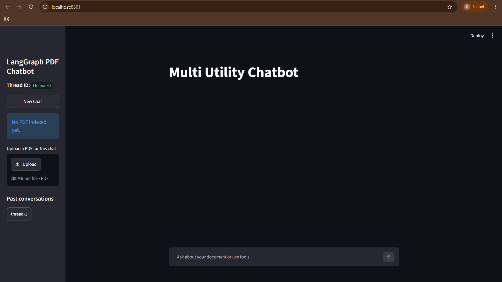
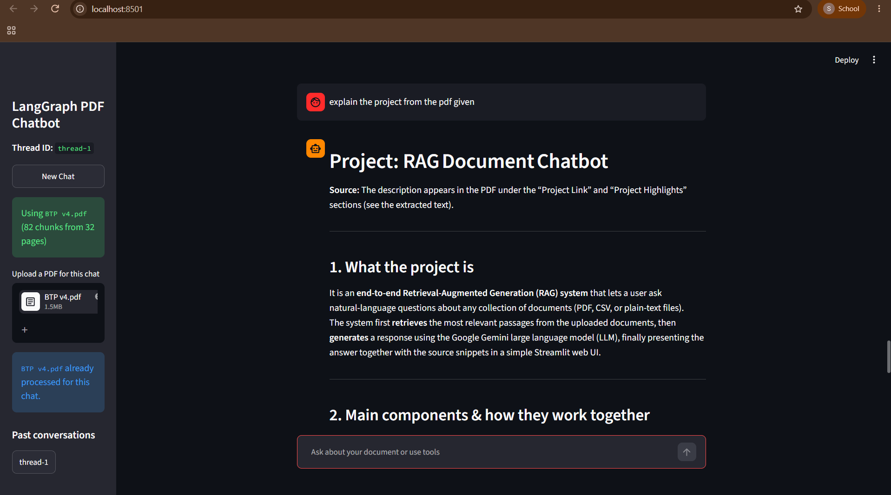
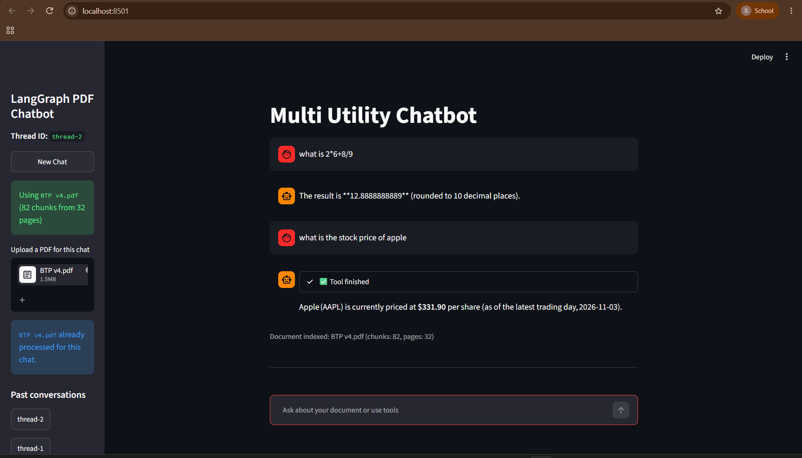

# Intelligent Multi-Utility AI Chatbot

An AI-powered conversational assistant built using **LangGraph, LangChain, and Streamlit**. It combines Retrieval-Augmented Generation (RAG) with multiple tools, allowing users to interact with PDF documents, search the web, retrieve stock prices, and perform mathematical calculations.

## Features

- **PDF-Based RAG:** Upload PDFs and ask questions based on their content.
- **Web Search:** Search the web using DuckDuckGo.
- **Stock Price Lookup:** Retrieve stock market quotes using the Alpha Vantage API.
- **Calculator:** Perform addition, subtraction, multiplication, and division.
- **Conversation Memory:** Maintain chat history using SQLite checkpointing.
- **Multi-Thread Conversations:** Create new chats and switch between previous conversations.
- **Streaming Responses:** Display AI-generated responses in real time.

## Tech Stack

| Category | Technologies |
|---|---|
| Programming Language | Python |
| LLM | Groq (GPT-OSS-120B) |
| Frameworks | LangChain, LangGraph |
| Frontend | Streamlit |
| Embeddings | Cohere |
| Vector Store | FAISS |
| PDF Processing | PyPDFLoader |
| Database | SQLite |
| Web Search | DuckDuckGo |
| Stock API | Alpha Vantage |

## Screenshots

### Home Interface


### PDF Chat


### Tool Integration


## Project Structure

```text
Intelligent-Multi-Utility-AI-Chatbot/
│
├── .env.example
├── .gitignore
├── LICENSE
├── README.md
├── app.py
├── backend.py
├── requirements.txt
├── home.png
├── pdf_chat.png
└── tools.png
```

## Installation & Setup

### 1. Clone the repository

```bash
git clone https://github.com/Sarrah-2/Intelligent-Multi-Utility-AI-Chatbot.git
cd Intelligent-Multi-Utility-AI-Chatbot
```

### 2. Create a virtual environment

```bash
python -m venv venv
```

Activate it:

**Windows**
```bash
venv\Scripts\activate
```

**Mac/Linux**
```bash
source venv/bin/activate
```

### 3. Install dependencies

```bash
pip install -r requirements.txt
```

### 4. Configure API Keys

Create a `.env` file in the project root using `.env.example` as a reference.

Add the following API keys:

```env
GROQ_API_KEY=your_groq_api_key
COHERE_API_KEY=your_cohere_api_key
ALPHA_VANTAGE_API_KEY=your_alpha_vantage_api_key
```

Keep your API keys private. Never upload your actual `.env` file to GitHub.

### 5. Run the application

```bash
streamlit run app.py
```

The application will open in your default browser.

## How It Works

1. Users upload a PDF through the Streamlit interface.
2. PyPDFLoader extracts the document content.
3. RecursiveCharacterTextSplitter divides the content into smaller chunks.
4. Cohere generates embeddings, which are stored in FAISS.
5. LangGraph manages the conversation workflow and tool execution.
6. The assistant retrieves relevant document content or uses external tools to answer queries.
7. SQLite checkpointing maintains conversation history across chat threads.

## Future Improvements

- Persistent storage of PDF vector indexes.
- Support for multiple document formats.
- Improved document source citations.
- Integration of additional tools and APIs.
- Enhanced document retrieval and response accuracy.

## License

This project is licensed under the MIT License.
